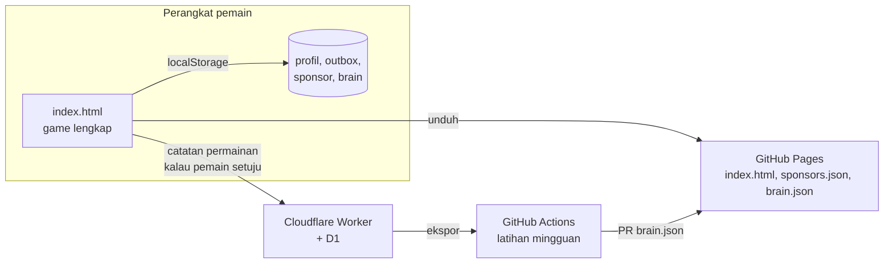
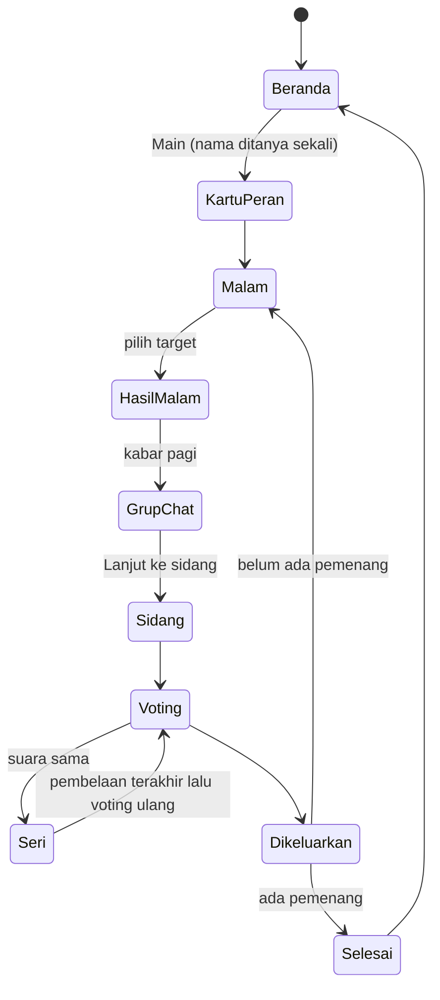
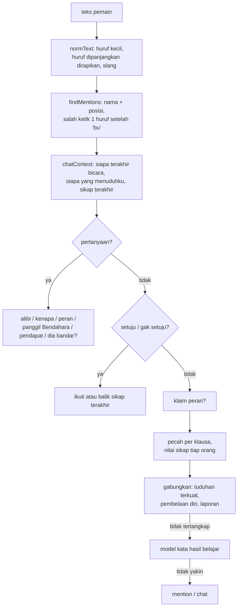
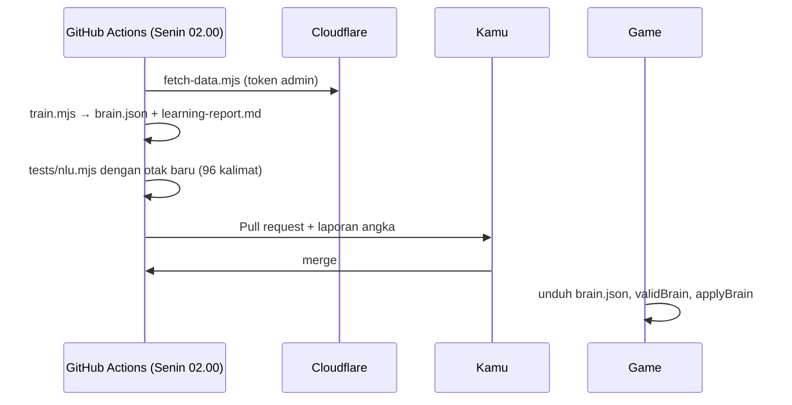

# Dokumentasi Teknis ARISAN

Dokumen ini menjelaskan teknologi, struktur kode, dan algoritma di balik ARISAN: aturan permainan, cara bot berpikir dan berbicara, cara bot memahami pesan pemain, dan cara bot belajar dari semua pemain. Rujukan baris kode ditulis sebagai nama fungsi di `index.html`, karena nomor baris berubah setiap kali kode diedit.

## Daftar isi
1. [Gambaran besar](#1-gambaran-besar)
2. [Teknologi](#2-teknologi)
3. [Struktur kode dan alur layar](#3-struktur-kode-dan-alur-layar)
4. [Aturan permainan](#4-aturan-permainan)
5. [Keacakan dan Arisan Harian](#5-keacakan-dan-arisan-harian)
6. [Otak bot: keyakinan](#6-otak-bot-keyakinan)
7. [Otak bot: penalaran](#7-otak-bot-penalaran)
8. [Otak bot: menyusun kalimat](#8-otak-bot-menyusun-kalimat)
9. [Alur obrolan grup dan drama](#9-alur-obrolan-grup-dan-drama)
10. [Memahami pesan pemain](#10-memahami-pesan-pemain)
11. [Sistem belajar dari pemain](#11-sistem-belajar-dari-pemain)
12. [Progres, hadiah, dan kocokan](#12-progres-hadiah-dan-kocokan)
13. [Sponsor](#13-sponsor)
14. [Tampilan](#14-tampilan)
15. [Build dan rilis](#15-build-dan-rilis)
16. [Pengujian](#16-pengujian)
17. [Resep perubahan umum](#17-resep-perubahan-umum)
18. [Batasan yang diketahui](#18-batasan-yang-diketahui)

---

## 1. Gambaran besar

ARISAN adalah permainan *social deduction* (sejenis Werewolf atau Among Us) bertema grup arisan ibu-ibu. Satu atau dua **Bandar Bodong** diam-diam menilep uang kas. Pemain lain harus menemukan mereka lewat obrolan grup, lalu mengeluarkannya lewat voting sebelum pertemuan ke-3 selesai.

Ada tiga mode:
- **Main sama ibu-ibu**: kamu melawan 5–7 bot yang berbicara, berdebat, dan berbohong.
- **Arisan Harian**: sama seperti mode bot, tapi pengacakannya sama untuk semua orang di hari itu.
- **Main bareng, oper HP**: 4–8 orang bergantian memakai satu HP.



Seluruh permainan berjalan di perangkat pemain. Server hanya dipakai untuk mengumpulkan catatan permainan yang dipakai melatih bot. Game tetap bisa dimainkan tanpa internet.

## 2. Teknologi

| Bagian | Teknologi | Alasan |
|---|---|---|
| Game | Satu file `index.html`: HTML, CSS, dan JavaScript murni tanpa framework dan tanpa build | Ringan (sekitar 200 KB), cepat dibuka di HP murah, dan mudah dibungkus jadi aplikasi |
| Grafis | Avatar dan sandal digambar sebagai SVG oleh kode (`avatarSVG`, `sandalSVG`) | Tidak ada file gambar. Setiap ibu unik dari kombinasi gaya kerudung, mata, alis, mulut, dan aksesori |
| Suara | Web Audio API, nada disintesis (`tone`, `sfx`) | Tanpa file audio |
| Huruf | Baloo 2 dan Nunito dari Google Fonts | Lisensi SIL OFL, bebas dipakai komersial |
| Penyimpanan | `localStorage` lewat pembungkus `store` | Profil, pengaturan, sponsor, otak bot, dan antrean catatan |
| Aplikasi HP | Capacitor 7 (Android dan iOS) | Membungkus `index.html` yang sama ke WebView native |
| Web | GitHub Pages | Hosting gratis untuk game, `sponsors.json`, dan `brain.json` |
| Server belajar | Cloudflare Worker + database D1 (SQLite) | Gratis untuk volume awal, cepat di Asia |
| Latihan bot | Node.js (`scripts/train.mjs`) di GitHub Actions | Tanpa dependensi, jalan setiap Senin |
| Uji | Playwright (Chromium dan WebKit) | Menguji permainan penuh dan pemahaman pesan di browser sungguhan |

Struktur repo:

```
index.html            game lengkap (satu-satunya sumber kode game)
privacy.html          kebijakan privasi
sponsors.json         daftar sponsor (diunduh game)
brain.json            otak bot hasil latihan (diunduh game)
server/               Cloudflare Worker: src/index.js, schema.sql, wrangler.toml
scripts/              build-web.mjs, make-assets.mjs, train.mjs, fetch-data.mjs
tests/                nlu.mjs + nlu-corpus.json (96 kalimat uji)
.github/workflows/    learn.yml (latihan mingguan)
android/, ios/        proyek native hasil Capacitor
docs/TEKNIS.md        dokumen ini
LEARNING.md, SPONSORS.md, RELEASE.md, STORE.md
```

## 3. Struktur kode dan alur layar

### Status global
| Variabel | Isi | Umur |
|---|---|---|
| `P` | Profil pemain: nama, XP, kue, kosmetik, prestasi, statistik, izin berbagi data, tips yang sudah dilihat | Disimpan permanen (`saveP`) |
| `G` | Satu permainan: pemain, peran, hari, kas, pesan, voting, kabar malam, catatan belajar (`G.rec`) | Dibuat ulang setiap `newGame` |
| `chat` | Antrean bicara hari ini (`queue`, `idx`), jatah pesan pemain (`sent`), status sidang | Dibuat ulang setiap pagi |
| `screen` | Nama layar yang sedang tampil | |
| `TUNE` | Angka keseimbangan permainan | Konstanta |

Setiap layar adalah satu fungsi yang memanggil `render(html)` lalu memasang event. `G.token` naik setiap kali layar berganti, sehingga timer obrolan yang masih berjalan dari layar lama berhenti sendiri (`later()` memeriksa token).

### Alur permainan



Fungsi utama per layar: `homeScreen`, `roleReveal`, `nightScreen`, `nightResult`, `dayScreen`, `startSidang`, `startVote`, `tieScreen`, `kickScreen`, `endScreen`. Mode oper HP memakai layar serah HP (`passSetup` dan layar "berikan ke …") supaya peran tetap rahasia. Siangnya tidak ada obrolan bot: pemain berdiskusi langsung dengan timer 3 menit (`passMorning`), lalu voting rahasia bergiliran.

## 4. Aturan permainan

### Peran
`roleList(n)` menyusun peran: selalu 1 Bandar dan 1 Bendahara, ditambah Bu RT mulai 5 pemain, Ratu Gosip mulai 6 pemain, Bandar kedua mulai 6 pemain (`TUNE.twoBandarFrom`), dan sisanya Warga.

| Peran | Tim | Aksi malam | Hasil |
|---|---|---|---|
| Bandar Bodong | bandar | Mengajak satu orang ngerumpi | Kas berkurang Rp1,15–1,4 juta. Target ngerumpi gagal beraksi dan besok pagi kena fitnah |
| Bendahara | warga | Mengaudit satu orang | Tahu pasti bandar atau bukan |
| Bu RT | warga | Menjaga satu orang | Ajakan ngerumpi ke orang itu ditolak dan fitnahnya diklarifikasi |
| Ratu Gosip | warga | Mencari kabar | Benar 65% (`TUNE.gosipAcc`) |
| Warga | warga | Mengintip satu rumah | Tahu apakah penghuninya keluar. Orang yang keluar hanya terlihat 60% (`TUNE.intipSeen`) |

Yang "keluar rumah" di malam hari: Bandar (selalu), serta Bendahara, Bu RT, dan Ratu Gosip kalau beraksi (`wentOut`). Akibatnya hasil intip "keluar" belum tentu berarti bandar.

### Urutan malam (`resolveNight`)
1. Kas berkurang kalau masih ada bandar.
2. Target yang dijaga Bu RT dikumpulkan.
3. Target ngerumpi bandar ditentukan. Kalau dijaga, ajakannya gagal (klarifikasi). Kalau tidak, orang itu tidak bisa beraksi malam itu dan besok kena fitnah.
4. Setiap peran mendapat hasilnya, lalu hasil itu dicatat ke `knowledge` masing-masing.
5. Dengan peluang 25% (`TUNE.sandalP`), muncul kabar sandal: warna sandal salah satu bandar. Saat pembagian sandal, setiap bandar dipastikan berbagi warna dengan minimal satu warga, jadi petunjuk ini tidak pernah langsung menunjuk satu orang.
6. Keyakinan bot diperbarui dari kabar pagi (lihat bagian 6).

### Menang dan kalah (`checkWin`)
- **Warga menang** kalau semua bandar keluar.
- **Bandar menang** kalau jumlah bandar ≥ jumlah warga, atau pertemuan ke-3 (`TUNE.maxDay`) selesai dan bandar masih ada.

### Voting (`tally`)
Suara terbanyak dikeluarkan; tidak perlu mayoritas (`TUNE.majority=false`). Kalau seri, orang-orang yang seri menyampaikan pembelaan terakhir, lalu voting ulang di antara mereka saja. Kalau masih seri, tidak ada yang keluar.

### Keseimbangan
`ArisanSim.simulate(jumlahPermainan, n)` memainkan permainan bot-lawan-bot tanpa tampilan. Target kemenangan warga adalah 50–65% untuk 6–8 pemain. Hasil terakhir: 55% (6 pemain), 61% (7), dan 62–65% (8). Untuk 4–5 pemain hanya ada satu bandar, jadi warga lebih sering menang (82–90%). Mode itu dipakai untuk oper HP dengan manusia, yang lebih licin daripada bot.

## 5. Keacakan dan Arisan Harian

Semua keputusan acak memakai `rnd()`. Di mode biasa sumbernya `Math.random`. Di Arisan Harian sumbernya `mulberry32(seed)`, sebuah pembangkit angka acak kecil yang deterministik, dengan seed dari tanggal (`20261024`). Karena itu peran, sandal, dan kabar malam sama untuk semua orang di hari itu. Nomor harian (`dailyNo`) dihitung dari tanggal awal (`DAILY_EPOCH`).

## 6. Otak bot: keyakinan

Setiap bot (selain bandar) menyimpan, untuk setiap orang lain, **odds** bahwa orang itu bandar: `beliefs[j]`. Odds dipakai karena bukti bisa dikalikan langsung (aturan Bayes dalam bentuk odds):

```
odds_baru = odds_lama × rasio_kemungkinan(bukti)
peluang   = odds / (1 + odds)          // prob(v, j)
```

- Nilai awal: `k / (n − 1 − k)`, dengan `k` jumlah bandar. Itu peluang dasar bila belum ada bukti.
- `mulBelief(v, j, f)` mengalikan odds dengan `f` dan membatasinya di 1e-4 sampai 1e4. Bandar dan pemain manusia tidak memakai sistem ini.
- `knowBandar` dan `knowInnocent` mengunci odds ke 1e4 atau 1e-4, misalnya setelah audit sendiri.
- `cred(v, from) = clamp(1 − 1,5 × prob(v, from), 0,05, 1)` adalah tingkat kepercayaan pada pembicara. Ucapan orang yang dicurigai hampir tidak berpengaruh.
- `pubSusp(j)` adalah rata-rata kecurigaan semua bot warga terhadap `j`. Dipakai bandar untuk memilih kambing hitam, dan dipakai untuk efek ikut-ikutan saat voting.

### Sumber bukti
| Peristiwa | Pengali odds | Tempat |
|---|---|---|
| Audit sendiri | dikunci pasti | `resolveNight` |
| Kabar gosip sendiri | ×3 atau ×1/3 | `resolveNight` |
| Intip: keluar / tidak terlihat | ×1,5 / ×0,45 | `resolveNight` |
| Fitnah pagi | × daya percaya kepribadian (`gull`, 1,15–2,0) | `resolveNight` |
| Klarifikasi Bu RT | ×0,8 | `resolveNight` |
| Sandal cocok dengan kabar | ×2,2 (×3 kalau warnanya sama dengan sandal sendiri) | `resolveNight` |
| Klaim Bendahara: bandar | × (1 + 5 × cred) | `applyMsg` |
| Klaim Bendahara yang terbukti bohong | pembicaranya ×8 | `applyMsg` |
| Dua orang mengaku Bendahara | keduanya dicurigai (×1,8 dan ×1,4) | `applyMsg` |
| Tuduhan biasa | × (1 + 0,5 × cred) | `applyMsg` |
| Tuduhan dengan bukti yang bisa dicek | tambahan ×1,25–3 (`VERIFIABLE`) | `applyMsg` |
| Dituduh sendiri | penuduhnya ×1,6 | `applyMsg` |
| Pembelaan | × 1/(1 + 0,35 × cred) | `applyMsg` |
| Membela orang yang sudah diaudit bandar | pembelanya ×3 | `applyMsg` |
| Bersumpah atau menangis | ×0,93 / ×0,9 | `applyMsg` |
| Salah kirim pesan mencurigakan | ×1,35 | `applyMsg` |
| Setelah seseorang dikeluarkan dan perannya terbuka | penuduh, pembela, pengaku Bendahara, dan pemilih ikut dinilai ulang | `applyKick` |
| Gelagat pemain manusia (dipelajari) | ×0,6 sampai ×1,6 sebelum voting | `applyTells` |

### Keputusan bot
- **Malam** (`botNightAction`):
  - Bendahara, Ratu Gosip, dan Warga menyelidiki orang yang paling dicurigai tapi belum pasti, ditambah sedikit acak sesuai kepribadian.
  - Bu RT menjaga orang yang mengaku Bendahara atau orang yang paling dipercaya.
  - Bandar mengajak ngerumpi pengaku Bendahara, atau orang yang paling tidak dicurigai.
- **Voting** (`botVote`): skor = peluang bandar + 0,2 × kecurigaan umum + 0,1 × dendam + acak sesuai kepribadian. Bandar memilih warga yang paling dicurigai umum. Kadang bandar juga mengorbankan rekannya kalau rekannya sudah pasti ketahuan.

### Kepribadian (`PERS`)
| Kepribadian | Banyak bicara | Mudah percaya fitnah | Acak | Pandai bohong |
|---|---|---|---|---|
| Julid | 0,95 | 2,0 | 0,12 | 0,65 |
| Polos | 0,6 | 1,7 | 0,25 | 0,3 |
| Bijak | 0,6 | 1,15 | 0,06 | 0,7 |
| Sosialita | 0,8 | 1,4 | 0,15 | 0,65 |
| Pendiam | 0,35 | 1,3 | 0,1 | 0,5 |
| Kepo | 0,95 | 1,6 | 0,15 | 0,45 |
| Baper | 0,75 | 1,5 | 0,2 | 0,4 |
| Tegas | 0,7 | 1,2 | 0,08 | 0,6 |

### Strategi bandar bot
Setiap bandar bot mendapat satu strategi acak (`BANDAR_STRATEGIES`, dijalankan di `bandarSpeak`):
- **kambing**: terus menuduh satu kambing hitam (`G.scape`).
- **palsu**: hampir pasti mengaku Bendahara palsu.
- **diam**: jarang bicara, sesekali membela orang acak.
- **drama**: banyak bicara dan menuduh balik siapa saja.
- **bestie**: mendekati pemain manusia, ikut menyetujui tuduhannya atau membelanya.

## 7. Otak bot: penalaran

Bot tidak menuduh secara acak. `deductions(v)` menyusun daftar fakta dari sudut pandang bot `v`, masing-masing dengan kekuatan:

| Jenis | Isi | Kekuatan |
|---|---|---|
| `fakeBend` | (hanya Bendahara asli) orang yang mengaku Bendahara pasti bohong | 0,98 |
| `liar` | pernah mengaku Bendahara, dan hasil klaimnya terbukti salah setelah peran terbuka | 0,95 |
| `deduce` | petunjuk sandal/CCTV cocok dengan beberapa orang, tapi yang lain sudah terbukti bersih, jadi tinggal satu | 0,85 |
| `alibi` | alibi untuk malam yang sama berubah saat ditanya lagi | 0,75 |
| `defendedBandar` | pernah membela orang yang ternyata bandar | 0,6 |
| `twoClaims` | dua orang sama-sama mengaku Bendahara | 0,55 |
| `ownIntip`, `ownGosip`, `ownAudit` | hasil aksi malam sendiri | 0,45–1 |
| `clue` | sandal/CCTV cocok, tapi masih ada kandidat lain | 0,4 |
| `seenOut` | orang lain melaporkan dia keluar rumah | 0,35 |
| `salah` | salah kirim pesan soal uang | 0,35 |
| `votePattern` | ikut mengeluarkan orang yang ternyata bersih | 0,3+ |
| `attacker` | sudah menuduh aku dua kali atau lebih | 0,3 |
| `rumor` | kena fitnah pagi | 0,2 |

- `bestReason(sp, t)` memilih alasan terkuat untuk menuduh (atau membela) `t`. Bandar hanya boleh memakai fakta publik, supaya tidak membocorkan rahasia yang tidak mungkin ia ketahui.
- `reasonText` mengubah alasan menjadi kalimat. Kalau alasan yang sama sudah diucapkan orang lain, bot merujuk ke ucapan itu ("seperti kata Bu Sri tadi") dan tidak mengulang isinya.
- Fakta yang bisa dicek (`VERIFIABLE`: bohong soal Bendahara, deduksi, alibi berubah) membuat tuduhan lebih meyakinkan bagi bot lain.
- `alibiFor(p, hari)` memberi setiap orang alibi yang unik untuk setiap malam. Bandar punya peluang 35% "lupa" dan menyebut alibi yang berbeda saat ditanya lagi. Perubahan inilah yang ditangkap fakta `alibi`.

## 8. Otak bot: menyusun kalimat

Kalimat tidak diambil utuh dari daftar. Kalimat dibangun dari **makna** (siapa, maksud, tingkat keyakinan, alasan), lalu diberi gaya bicara.

1. **Pesan sebagai data.** Bot menghasilkan objek seperti `{from, type:'accuse', target, why, core}`. Teksnya baru dibuat saat pesan akan tampil (`textFor` → `genText`).
2. **Generator per maksud**: `genAccuse`, `genDefend`, `genDeny`, `genClaim`, `genReveal`, `genAgree`, `genDisagree`, `genAnswer`, `genAlibi`, `genExplain`, `genInsist`, dan `genShort`.
   - Contoh `genAccuse`: tingkat keyakinan (0–3) dari `prob` menentukan kerangka kalimat, dari "aku agak curiga sama…" sampai "aku yakin seratus persen…". Bentuk kalimat dipilih dari empat pola: kesimpulan + alasan, alasan + kesimpulan, pertanyaan ke tersangka, atau alasan saja.
   - Contoh `genDeny`: menjawab isi tuduhan. Kalau dilaporkan keluar rumah, ia memberi alasan keluar. Kalau soal sandal, ia menunjuk orang lain yang sandalnya sama warna. Kalau warna sandal yang disebut salah, ia mengoreksinya. Kadang ia juga menuduh balik dengan alasannya sendiri.
3. **Sapaan** (`addr`): Sosialita memanggil "Jeng Ratna", Tegas memanggil nama saja, dan "Bu Hajjah Siti" kadang disingkat "Bu Hj. Siti".
4. **Gaya bicara** (`finish`): pembuka dan penutup khas kepribadian (`VOICE`, misalnya Julid "Hmm… 🙄", Bijak "Mohon maaf, …"), partikel (`PARTICLE`: lho, sih, deh, ya), tanda seru saat emosi (`mood`), dan HURUF BESAR saat sangat emosi.
5. **Anti-pengulangan**: `G.used` mencatat kalimat yang sudah tampil. Kalimat yang sama tidak keluar dua kali.

Kalimat skenario untuk drama (sindiran, debat panjang, khianat, sidang) ada di tabel `CORE` dan juga diberi gaya oleh `compose`.

## 9. Alur obrolan grup dan drama

### Rencana bicara harian (`planSpeakers`)
Setiap pagi disusun antrean blok yang tidak boleh dipotong:
1. **Pembuka**: reaksi atas fitnah pagi.
2. **Pemegang info**: bot yang punya hasil malam.
3. **Obrolan dan drama** yang berselang-seling. Peluang bicara setiap bot mengikuti nilai `talk`-nya. Drama yang mungkin muncul:
   - Debat musuh bebuyutan: sindiran di hari 1, debat 7 langkah di hari berikutnya.
   - Pengkhianatan besti (hari 2 ke atas, kalau salah satunya dicurigai).
   - 2–3 kejutan acak: salah kirim pesan (lalu dihapus), voice note, CCTV warung, paket COD, curhat korban fitnah, pengakuan palsu, rapat darurat Bu RT yang memaksa yang pendiam bicara, dan screenshot yang membongkar Bendahara palsu.
   - Kue sponsor di hari pertama, kalau ada sponsor slot kue.

### Tanggapan berantai (`followUps`)
Setelah setiap pesan:
- Orang yang dituduh membalas (peluang 85%, maksimal 2 kali per hari).
- Bendahara asli langsung membantah klaim Bendahara palsu.

Penjaga *ping-pong* mencegah dua bot saling membalas tanpa akhir.

### Tempo (`tick`, `paceAfter`)
Tempo mengikuti riset waktu baca: rata-rata orang dewasa membaca 238 kata per menit (meta-analisis Brysbaert 2019), dan studi kecil di Indonesia menemukan sekitar 155 kata per menit. Mengetik di HP rata-rata 36 kata per menit (Palin dkk. 2019). Jeda yang menyesuaikan panjang pesan membuat bot terasa lebih manusiawi (Gnewuch dkk. 2018).

- Pesan berikutnya tidak pernah muncul sebelum pesan sebelumnya cukup waktu dibaca pada 155 kata per menit (`readMs` × `read`: Santai 1,3, Normal 1, Cepat 0 untuk membaca sekilas). Waktu dasar animasi mengetik ikut dihitung, karena pemain tetap membaca selama animasi tampil.
- Pesan penting (klaim, laporan, bukti, kabar, salah kirim) mendapat tambahan waktu berpikir (`key`: 2 / 1,5 / 0,5 detik).
- Kabar pagi muncul satu per satu. Dalam ±1,4 detik sudah ada ibu yang "sedang mengetik", supaya grup langsung terasa hidup (pedoman Nielsen: umpan balik dalam ±1 detik, perhatian hilang setelah ±10 detik). Waktu membaca kabar berjalan bersamaan dengan pesan pertama dan dibatasi 3,5 detik, sehingga pesan pertama muncul dalam ±7,5–9 detik. Sebelumnya, layar diam 17–23 detik.
- Hasil pengukuran satu hari obrolan: jarak antar-pesan median 10,2 detik (Santai) dan 7,6 detik (Normal), tanpa satu pun pesan yang menyalip pembaca. Sebelumnya, di Normal, 9 dari 17 pesan muncul sebelum selesai dibaca.
- Game mencatat kecepatan yang dipakai (`speed`), berapa kali diganti (`sc`), dan jeda pemain sebelum membalas (`rl`). Laporan mingguan menampilkan bagian "Tempo obrolan", supaya tempo bisa disesuaikan dari perilaku pemain sungguhan.


- Pesan muncul setelah indikator "sedang mengetik". Lama mengetik dan jeda antar-pesan mengikuti kecepatan (`SPEEDS`: santai, normal, cepat).
- Kalau pemain sedang mengetik (`playerBusy`), bot menunggu.
- Saat pemain diminta membela diri di sidang, bot menunggu sampai 12 detik.
- Bot yang dituduh 3 kali atau lebih bisa "ngambek keluar grup", lalu dimasukkan lagi oleh Bu RT.
- Meter suasana (`addHeat`) naik dari tuduhan dan drama: Adem → Mulai panas → Panas → Membara.

### Sidang (`startSidang`)
Dua orang yang paling dicurigai diberi kesempatan membela diri. Kalau pemain termasuk tersangka, jatah pesannya dibuka lagi. Lalu satu saksi membongkar alasan terkuatnya. Setelah itu tombol berubah menjadi "Voting sekarang".

## 10. Memahami pesan pemain

Pemain bebas mengetik (maksimal 5 pesan per hari). `parseHuman(text)` mengubah teks menjadi maksud, misalnya `{type:'accuse', target:3}` atau `{type:'ask', ask:'alibi', addressee:2}`.



### Tahapan
1. **Normalisasi** (`normText`):
   - Huruf yang dipanjangkan dirapikan ("bandarnyaaa" → "bandarnya").
   - Lebih dari 30 aturan slang diterapkan, misalnya gk/ga/nggak → gak, gw → aku, km/lu → kamu, smlm → semalam, sus → curiga, boong → bohong, kmn → ke mana.
   - Slang hasil belajar (`brain.json`) ikut diterapkan.
2. **Nama** (`findMentions`):
   - Nama dicocokkan per kata, beserta posisinya.
   - Awalan 4 huruf juga diterima ("ratn" → Ratna).
   - Salah ketik satu huruf (jarak Levenshtein 1) hanya diterima kalau didahului "bu", "jeng", "si", dan sejenisnya. Dengan begitu kata biasa seperti "indah" tidak terbaca sebagai Bu Endah.
3. **Konteks** (`chatContext`), dari 8 pesan bot terakhir:
   - pesan terakhir;
   - tuduhan terakhir terhadapku;
   - klaim bermusuhan terakhir;
   - sikap terakhir soal orang lain;
   - siapa yang sedang bicara kepadaku.
   
   Konteks ini dipakai untuk mengartikan "dia", "kamu", "setuju", dan "buktinya apa?".
4. **Vokatif**: kalimat yang diawali nama ("Bu Sri, …") berarti ditujukan ke Bu Sri, bukan membicarakannya.
5. **Pertanyaan** dibedakan menjadi:
   - `alibi` (ke mana / ngapain semalam);
   - `why` (kenapa nuduh, buktinya apa);
   - `role` (peranmu apa);
   - `callRole` (siapa Bendaharanya, ngaku dong);
   - `opinion` (menurutmu siapa);
   - `about` (Bu X bandar ya?).
6. **Setuju / tidak setuju** mengikuti atau membalik sikap terakhir di grup, sekaligus mencatat siapa yang disetujui.
7. **Klausa**: kalimat dipecah di koma, titik, "tapi", "padahal", "justru", "malah", dan "karena". Setiap klausa diberi nilai sikap terhadap orang yang disebut:
   - kata tuduhan +1;
   - kata pembelaan −1;
   - negasi dalam 3 kata sebelumnya membalik nilai ("gak curiga", "gak percaya");
   - ajakan vote atau keluarin +1,5;
   - "jangan pilih" −1;
   - ungkapan penegas seperti "gak salah lagi" tidak dihitung sebagai negasi.
   
   Klausa tentang diri sendiri ("aku bukan bandar", "aku bersih") menjadi pembelaan diri. Klausa "X nuduh aku terus" menjadi tuduhan balik. Fakta sandal diperiksa: kalau warnanya salah, tersangka akan membantah dengan warna aslinya.
8. **Penggabungan**: orang dengan nilai tertinggi menjadi target utama. Sikap lain dalam kalimat yang sama tetap dicatat sebagai pesan tambahan (`extra`), misalnya "Bu Sri bukan bandar, Bu Wati yang bandar".
9. **Keyakinan**: setiap tebakan punya skor keyakinan (`conf`). Tebakan dari kata yang jelas bernilai 0,85. Tebakan yang lemah dan tidak bergantung konteks (misalnya hanya "bukan" + nama) bernilai 0,55 dan ditandai boleh dikalahkan (`ovr`).
10. **Model kata**: kalau aturan tidak menangkap maksudnya, model naive Bayes hasil belajar menebak, di atas ambang `nb.min`. Model juga boleh **mengalahkan** tebakan aturan yang lemah (`ovr`) di atas ambang `nb.override`, tapi hanya kalau latihan membuktikan model lebih tepat daripada aturan pada pesan seperti itu. Model tidak membaca konteks obrolan, jadi tebakan yang bergantung konteks (setuju, membalas penuduh, dia/kamu) tidak pernah dikalahkan. Tanpa nama, model hanya boleh menebak pertanyaan kalau kalimatnya memang bertanya.

### Lapisan makna (`semRead`)
Pola kata kunci menebak dari kata yang muncul. Lapisan makna menyusun **struktur**: siapa (pelaku) melakukan apa (predikat) kepada siapa (objek). Sikap terhadap setiap orang dihitung dari makna predikatnya. Satu kata kerja yang dikenal berlaku untuk semua susunan kalimatnya.

```
"jangan percaya dulu, bisa jadi itu fitnah terhadap Bu Lilis"
  percaya(objek: kabar tentang Bu Lilis) + "jangan"  → kabarnya diragukan → Bu Lilis +
  fitnah(objek/korban: Bu Lilis)                      → Bu Lilis korban   → Bu Lilis +

"uang kas dibawa kabur Bu Wati"        dibawa(pasif, pelaku: Bu Wati)   → Bu Wati −
"bukan Bu Endah yang ngambil"          ngambil(subjek terbalik + "bukan") → Bu Endah +
"yang fitnah Bu Endah itu bandarnya"   bandar = si pemfitnah, Bu Endah korban → Bu Endah +
"aku gak yakin Bu Lilis bersih"        "gak yakin" membalik isinya       → Bu Lilis −
```

Komponennya:
- **Kamus predikat** (`SEMX`): sikap pembicara (percaya, curiga, ragu), keberpihakan (bela, dukung, pilih, keluarin, awasi), perbuatan buruk (nilep, nyolong, bawa kabur, fitnah, jebak, tipu, ngeles, cari muka), bentuk pasif (difitnah, dijebak, dicuri, dibela), sifat (bandar, jujur, licik, polos), serta kabar dan omongan beserta kredibilitasnya (benar, masuk akal, hoaks, ngarang, gak berdasar).
- **Frasa** (`SEM_PHRASES`) diringkas jadi satu makna: "mana mungkin" → negasi, "bawa kabur" → bawa, "cari muka" → caper, "salah sangka" → keliru.
- **Struktur**:
  - subjek adalah orang terdekat di kiri predikat;
  - objek adalah orang atau kabar terdekat di kanan, termasuk objek berganda ("Bu Lilis sama Bu Wati");
  - kalimat terbalik ("bukan X yang …", "yang … bukan X");
  - pelaku di anak kalimat "yang fitnah X" tidak dianggap X.
- **Cakupan negasi**: "gak/bukan/jangan/masa/susah/stop" hanya membalik predikat yang diikutinya. "Gak bilang", "siapa bilang", dan "gak yakin" membalik seluruh isi sesudahnya. "Terlalu baik buat jadi bandar" membalik sifat setelah "buat jadi".
- **Kabar**: "kabar/gosip soal X" adalah kabar tentang X (kabar yang dipercaya membuat X −). "Omongan/alibi/cerita X" adalah milik X (yang masuk akal membuat X +). Kabar tanpa nama merujuk ke orang yang sedang difitnah pagi itu.
- **Keraguan** ("kayaknya", "mungkin", "aku rasa") memberi bobot 0,7.

Hasil lapisan makna menang atas pola lama untuk orang yang dibacanya. Pola lama tetap menjadi cadangan untuk kalimat yang tidak punya struktur yang dikenali. `semDebug(teks)` di `ArisanSim.debug` menampilkan struktur yang dibaca bot.

### Konteks percakapan (`chatContext`, `resolveRefs`)
Pesan dibaca bersama percakapan sebelumnya, **termasuk pesan pemain sendiri**:

| Pemain menulis | Konteks | Dibaca sebagai |
|---|---|---|
| "soalnya dia keluar rumah semalem" | sebelumnya: "aku curiga Bu Sri" | menuduh Bu Sri, dengan alasan |
| "Bu Dewi juga" | sebelumnya menuduh Bu Sri | menuduh Bu Dewi |
| "kalau Bu Wati?" | sebelumnya bertanya alibi Bu Dewi | bertanya alibi Bu Wati |
| "iya dia", "tetap dia orangnya" | sebelumnya menuduh Bu Sri | menegaskan tuduhan |
| "maaf ya Bu Sri, aku salah tuduh" | | menarik tuduhan, membela Bu Sri |
| "semalem aku di rumah aja nonton tv" | Bu Lilis baru menuduhku | membela diri dari Bu Lilis |
| "kayaknya Bu Lilis sih" | | menuduh Bu Lilis (keyakinan rendah) |

**Rujukan dengan deskripsi** diganti nama orangnya sebelum dibaca:
- "yang ngaku bendahara", "bendahara palsu itu";
- "yang lihat", "yang ketahuan keluar";
- "yang diaudit", "yang dituduh tadi";
- "yang digosipin tadi pagi", "yang kena fitnah";
- "yang nuduh aku", "yang barusan ngomong", "yang dari tadi diem";
- "yang sandalnya merah".

Kalau sudah ada nama sebelumnya, "bendahara palsu" diperlakukan sebagai tuduhan, bukan rujukan. Percaya pada pemberi pendapat ("aku percaya sama yang ngaku bendahara") berarti setuju dengan pendapatnya.

### Pola dari pesan pemain sungguhan
Dari laporan data pemain (27 permainan pertama), ada pola yang belum dikenal dan sekarang ditangani:

| Pola | Contoh | Dibaca sebagai |
|---|---|---|
| Sindiran tanpa nama | "kok tiba-tiba ada yang banyak uang", "ada yang COD bayarnya tunai" | menuduh orang yang dikabarkan atau yang menerima paket |
| Sindiran soal klaim | "bendahara kok ada dua", "maling mana ada ngaku" | menuduh pengaku Bendahara terakhir / yang barusan menyangkal |
| Menagih kontradiksi orang lain | "jadinya telponan atau nyetrika? omonganmu beda-beda" | menuduh orang itu (`plinplan`) |
| Sapaan di akhir | "ngaku aja, Bu Lilis", "kok kamu bela Bu Endah sih, Bu Ratna" | teguran / mencurigai si pembela |
| Menarik ucapan lalu menuduh | "maaf Bu Wati aku salah kira. Bandarnya kayaknya Bu Sri…" | menuduh Bu Sri, membela Bu Wati |
| Kata baru | "lagi panik/gugup", "denger kata Bu Sri" | mencurigakan / setuju dengan pendapat Bu Sri |
| Larangan ke penuduh | "Bu Wati jangan ngarang" | teguran (bukan bukti Bu Wati jujur) |

Catatan permainan kini juga menyimpan kabar pagi dan petunjuk (fitnah, sandal, paket COD), dan guru otomatis ikut membacanya.

**Akurasi pada pesan nyata** (dibaca ulang dengan parser terbaru; label guru diperiksa manual untuk kasus yang meragukan): sampel audit acak **73% → 93%** (30 pesan), semua pesan berlabel **60% → 88%** (60 pesan). Kalimat-kalimat ini dipakai untuk memperbaiki bot, jadi angka ini bukan lagi ujian buta. Ujian buta berikutnya adalah permainan-permainan selanjutnya, yang tampil di laporan mingguan.

### Bertanya balik saat ragu (`confirmReply`, `genClarify`)
Kalau keyakinan bot di bawah 0,6 dan ada orang yang disebut, bot **tidak langsung bereaksi**. Orang yang disebut (atau ibu yang paling kepo) bertanya balik, misalnya "Maksudnya Bu Susi percaya sama aku?" atau "Bu Sri kenapa, Bu Susi? Curiga atau gimana?". Maksimal dua kali per hari.

- Selama belum dijawab, pesan itu tidak mengubah keyakinan bot mana pun.
- Jawaban singkat "iya" mengonfirmasi tebakan, sedangkan "bukan" membalik tuduh ↔ bela. Jawaban ini tidak memakai jatah pesan.
- Konfirmasi dicatat sebagai label `x`, yaitu data latih paling tepercaya (bobot 3), tanpa tombol koreksi apa pun.

### Bot menginterogasi dan menagih (`probeSpeak`, `genCallout`)
- **Bertanya ke pemain**: setiap hari satu ibu (kepo, julid, tegas, atau sosialita) menanyai pemain, menyesuaikan apa yang sudah pemain lakukan:
  - alibi ("semalam ngapain aja?");
  - alasan menuduh ("kenapa yakin banget sama Bu X?");
  - alasan membela ("kok belain Bu X terus?");
  - pendapat, kalau pemain dari tadi diam.
  
  Bot menunggu jawaban sampai 15 detik ("Ibu-ibu menunggu jawabanmu…"), lalu si penanya menanggapi.
- **Menagih ucapan yang bertentangan:**
  - alibi yang berubah kelompok, misalnya dari "di rumah" (`H_ACTS`) ke "ke warung";
  - alibi "di rumah" padahal ada laporan intip yang melihat pemain keluar;
  - sikap yang berbalik terhadap orang yang sama (menuduh, lalu membela).
  
  Menarik ucapan dengan sengaja ("aku salah tuduh") tidak ditagih. Alibi pemain yang berubah juga masuk ke penalaran bot (`deductions` → `alibi`), sama seperti bandar bot yang lupa alibinya.

### Bandar yang menyesuaikan siasat
Selain strategi awal, bandar bot membaca keadaan:
- mengaku Bendahara palsu saat dirinya mulai dicurigai;
- mengorbankan rekan yang sudah pasti ketahuan;
- ikut menumpuk tuduhan ke pemain yang sedang disorot.

Bobot pemilihan strategi awal (`brain.json` → `bandar`) dihitung **self-play** (`scripts/selfplay.mjs`): setiap strategi dimainkan ratusan kali bot melawan bot, lalu bobotnya disesuaikan dengan hasilnya. Keseimbangan warga dijaga 50–68%. Hasil terakhir: bandar yang diam paling sering lolos (52%), bandar yang heboh paling sering ketahuan (36%).

### Sakelar eksperimen (`flag`, `brain.json` → `exp`)
Fitur baru (`probe`, `callout`, `adaptiveBandar`, `learnedLR`) bisa dinyalakan untuk sebagian pemain saja, misalnya `"exp":{"probe":0.5}`. Pembagiannya memakai angka acak yang hanya tersimpan di perangkat. Catatan permainan menyimpan fitur mana yang aktif, dan laporan mingguan membandingkan kelompok nyala dan mati: tingkat salah paham, tingkat keluar di tengah permainan, dan kemenangan pemain.

### Siapa yang menjawab (`sendHuman`, `botReply`)
| Maksud pemain | Penjawab | Isi jawaban |
|---|---|---|
| Menuduh X | X, lalu satu bot lain | X membantah sesuai isi tuduhan. Bot lain setuju atau tidak, sesuai keyakinannya sendiri |
| Setuju dengan Y soal X | X, Y, satu bot lain | Y berterima kasih ("Nah kan…") |
| Tanya alibi X | X, lalu satu saksi | Alibi (bisa berubah kalau X bandar). Saksi yang pernah mengintip X ikut melapor |
| Tanya kenapa ke Y | Y | Alasan terkuat Y, atau "cuma feeling" |
| Tanya peran X | X | Mengelak, mengaku warga, atau membuka kartu sesuai perannya |
| Panggil Bendahara | Bendahara asli (60%), bandar strategi palsu (40%), satu komentator | Membuka hasil audit atau klaim palsu |
| Membela diri | Penuduh terakhir, satu bot lain | Penuduh mundur kalau tidak terlalu curiga. Kalau curiga, ia bertahan dengan bukti |
| Salam, tawa, terima kasih | 1–2 bot | Balasan sewajarnya |

Akurasi (`tests/nlu.mjs --all`):
- Korpus pengembangan: 321/321 kalimat, dipakai saat menyusun aturan, lapisan makna, dan konteks.
- **Set uji tertutup 1** (`tests/nlu-holdout.mjs`, 150 kalimat, pedoman label di `tests/LABELS.md`): 89 (59%) → 136 (91%) dengan perbaikan pola → 138 (92%) dengan lapisan makna → **139 (92,7%)** dengan konteks.
- **Set uji tertutup 3** (`tests/nlu-holdout3.mjs`, 40 percakapan: pesan pemain sebelumnya, rujukan deskriptif, jawaban alibi, jawaban satu nama, menarik ucapan): **7 (17,5%) → 40 (100%)** dengan fitur konteks. Ditulis sebelum fitur konteks dibuat.
- **Set uji tertutup 2** (`tests/nlu-holdout2.mjs`, 80 kalimat dengan susunan bervariasi: pasif, korban/pelaku, cakupan negasi, kabar): **38 (47,5%) dengan pola saja → 71 (88,8%) dengan lapisan makna.** Set ini ditulis sebelum lapisan makna dibuat dan tidak dipakai untuk menyusunnya.

Perbandingan dengan LLM di Cloudflare Workers AI (`bench/`), pada set tertutup yang sama:

| Pendekatan | Akurasi |
|---|---|
| Aturan saja (pola, sebelum lapisan makna) | 90,7% |
| LLM saja | 66,7–87,3% (Llama 3.1 8B sampai Llama 3.3 70B) |
| Aturan + LLM hanya saat aturan ragu (7% pesan) | 92,0–93,3% (terbaik Qwen3 30B, 0,6 detik) |

Keputusan: game memakai aturan saja (offline, gratis, privasi tidak berubah). LLM baru dipasang kalau tingkat salah paham di lapangan bertahan di atas 10%.

## 11. Sistem belajar dari pemain

Detail operasional ada di `LEARNING.md`. Bagian ini menjelaskan algoritmanya.

### Data
Hanya dikirim kalau pemain menekan **Ya, bantu** (`P.share`). `recordGame` menyusun catatan berisi:
- peran semua pemain, hasil, dan voting;
- jenis pesan bot (tanpa teks);
- pesan pemain, dalam bentuk:

```json
{"d":1, "n":"<p1> auranya gelap", "l":"mention", "c":0.3, "t":1, "ts":95, "cx":[[1,"claimBend",0,true]], "g":null}
```
`n` = teks yang sudah dinormalisasi dan disamarkan (`anonNorm`), `l` = tebakan aturan, `c` = keyakinan aturan, `ts` = detik sejak permainan dimulai, `cx` = tiga pesan bot terakhir sebagai konteks untuk guru otomatis, `g` = keyakinan model kata kalau model yang menebak.

Catatan disimpan dulu di antrean `outbox` (maksimal 20). Kalau sedang offline, antrean dikirim saat game dibuka berikutnya (`flushOutbox`).

### Server (`server/src/index.js`)
- `sanitize` membuang field yang tidak dikenal, memeriksa jenis dan rentang setiap nilai, serta menolak teks yang berisi karakter di luar huruf, angka, dan tanda baca dasar.
- Pembatasan: 30 kiriman per jam per hash IP. Hash IP dihapus setelah 2 hari dan catatan dihapus setelah setahun.
- **Guru otomatis** (`teach`, cron setiap jam, juga `POST /v1/teach` bertoken admin): memberi label pesan yang membuat aturan ragu memakai prompt yang sama dengan benchmark (`bench/prompt.mjs`), disimpan di tabel `teacher`, dan ikut terekspor sebagai `tl`.
- Ekspor dilindungi token admin, dicek dengan perbandingan waktu-konstan.

### Model kata (naive Bayes multinomial)
Untuk setiap pesan, token berisi kata dan pasangan kata berurutan (bigram). Nama orang diganti `xp`. Peluang kelas `c` (accuse, defend, deny, question, ask_alibi, ask_why, ask_role, chat):

```
skor(c) = log P(c) + Σ log P(token | c)
P(token | c) = (jumlah token di c + 1) / (total token di c + ukuran kosakata)     // Laplace
keyakinan = 1 / Σ exp(skor(k) − skor_maks)
```

- **Label dan bobot:**

Bot belajar **tanpa koreksi manual**. Setiap pesan diberi label dari sumber paling tepercaya yang tersedia:

| Sumber | Bobot | Artinya |
|---|---|---|
| **Guru otomatis** (`tl`) | 2 | Setiap jam, server meminta LLM di Cloudflare Workers AI (Qwen3 30B, cadangan Llama 3.3 70B) memberi label pada pesan yang membuat aturan ragu, ditambah audit acak sekitar 10% pesan yang dibaca aturan dengan yakin (supaya salah baca yang percaya diri ikut ketahuan). Nama diganti samaran Bu A, Bu B, …, dan peran rahasia tidak pernah dikirim. Maksimal 40 pesan per jam |
| **Pesan susulan** | 1,5 | Pesan ragu yang langsung disusul (≤ 60 detik) pesan yang jelas soal orang yang sama: maksudnya mengikuti pesan susulan |
| **Voting** | 1,5 | Pemain menyebut X, aturan membacanya "membela" atau tidak paham, lalu pemain memilih X: pesannya bermusuhan dengan X |
| Tebakan aturan yang yakin | 1 | Keyakinan ≥ 0,8 |

Pilihan pemain dari versi lama ("Maksudmu?", bobot 3) tetap dipakai kalau ada di data lama.

  Tebakan model sendiri tidak dipakai untuk latihan, supaya kesalahannya tidak makin menguat.
- **Ambang "boleh mengalahkan aturan"** (`nb.override`): pada pesan uji yang membuat aturan ragu, ambang terendah di mana model minimal 85% tepat **dan** 5 poin lebih tepat dari aturan. Kalau tidak ada, model belum boleh mengalahkan aturan.
- **Kosakata**: maksimal 3.000 token yang muncul minimal 3 kali.
- **Ambang keyakinan**: dipilih dari 20% data uji, yaitu ambang terendah dengan presisi ≥ 90%.
- **Syarat dikirim**: model baru dikirim kalau ada minimal 200 contoh.

### Gelagat pemain manusia
Untuk setiap hari permainan, perilaku pemain diringkas menjadi tujuh ciri: menuduh, menuduh 2 kali atau lebih, membela, menyangkal, diam, mengaku Bendahara, dan bertanya. Untuk setiap ciri dihitung rasio kemungkinan:

```
LR(ciri) = P(ciri | pemain bandar) / P(ciri | pemain warga)      // smoothing Laplace, dibatasi 0,6–1,6
```
- **Syarat dipakai**: minimal 30 hari-pemain per kelompok, dan ciri yang muncul kurang dari 10 kali diabaikan.
- **Penerapan**: sebelum voting, `applyTells` mengalikan semua ciri yang muncul hari itu (total juga dibatasi 0,6–1,6). Hasilnya dikalikan ke kecurigaan setiap bot warga terhadap pemain.
- **Contoh**: kalau data menunjukkan pemain yang jadi bandar cenderung diam, pemain yang diam akan sedikit lebih dicurigai bot.

### Tingkat salah paham
Ukuran utama apakah bot makin pintar:

```
tingkat salah paham = (pesan yang tidak dipahami aturan + pesan yang tebakan aturannya dibantah guru, voting, atau pesan susulan) / semua pesan pemain
```
Patokannya di bawah 10%. Laporan mingguan menampilkan angka minggu ini, tren dibanding minggu lalu, riwayat 12 minggu (`brain.json` → `history`), salah tangkap terbanyak (misalnya `defend → accuse`), dan kata yang sering muncul di pesan yang gagal dipahami. Kata baru masuk daftar kalau dipakai minimal 10 kali, jadi tidak ada teks utuh pemain di laporan publik.

Kalau angka ini bertahan di atas patokan walaupun aturan sudah diperluas, pilihan berikutnya sudah diukur: memanggil LLM di Cloudflare Workers AI hanya untuk pesan yang membuat aturan ragu (lihat bagian 10 dan `bench/`).

### Bobot bukti dari permainan nyata (`brain.json` → `lr`)
Rumus keyakinan bot (bagian 6) memakai rasio kemungkinan untuk setiap jenis bukti. Nilai bawaannya (`LR_DEFAULT`) sama persis dengan rumus awal. Setiap minggu, `train.mjs` menghitung ulang dari permainan nyata seberapa sering sasaran setiap bukti memang bandar, dibanding peluang dasar:

```
LR = odds(sasaran benar bandar | bukti) / odds(peluang dasar)        // smoothing Laplace, dibatasi 0,15–10
```

Dihitung terpisah untuk laporan intip, kabar Ratu Gosip, klaim Bendahara, tuduhan dan pembelaan bot, serta **tuduhan dan pembelaan pemain manusia**. Nilai baru dipakai kalau sudah ada minimal 30 kejadian. Contoh dari 11 permainan pertama: tuduhan pemain hanya tepat 35% (LR 0,83), jadi bot belajar lebih kritis terhadap tuduhan pemain. Tuduhan bot LR 1,41, dekat dengan tebakan awal 1,5.

### Ukuran kecerdasan di laporan mingguan
- **Akurasi dunia nyata**: audit acak guru (~10% pesan, sampel tak bias) dibandingkan tebakan aturan, serta tebakan yang dikonfirmasi pemain lewat pertanyaan balik.
- **Bot melawan pemain**: berapa persen pemain yang jadi bandar tertangkap, dan berapa persen pemain warga yang salah dikeluarkan.
- **Bobot bukti, eksperimen, self-play, tempo, dan tingkat salah paham.**
- `scripts/real-exam.mjs` mengambil sampel pesan nyata yang sudah tersamar ke `data/real-exam.jsonl` (privat), untuk diperiksa manual dan dijadikan kasus uji baru.

### Siklus mingguan


### Pengaman di game (`validBrain`)
- `brain.json` hanya berisi data, tidak pernah kode.
- Slang hanya boleh berupa huruf kecil.
- Kelas model dibatasi daftar resmi.
- Ambang keyakinan dibatasi 0,6–0,99.
- Gelagat dibatasi 0,6–1,6.
- File yang rusak diabaikan, dan game memakai otak terakhir yang valid.

## 12. Progres, hadiah, dan kocokan

- **XP setiap permainan**:
  - 10 untuk ikut bermain;
  - +20 kalau menang;
  - +5 per suara yang mengenai bandar;
  - +5 kalau masih di grup sampai akhir;
  - +10 untuk Arisan Harian pertama hari itu.
- **Pangkat** (`RANKS`): Anggota Baru (0) → Langganan Arisan (80) → Bendahara Teladan (250) → Ketua RT (600) → Sesepuh Arisan (1.200) → Ratu Arisan Se-Kecamatan (2.200).
- **Kue**: 6 kalau menang, 2 kalau kalah. Dipakai di Lemari untuk membeli kosmetik (kerudung, bingkai, gelar). Kue tidak bisa dibeli dengan uang.
- **Kocokan arisan** (hadiah tak terduga setelah setiap permainan):
  - Peluang = `min(50%, 1/n + 5% × jumlah kocokan berturut-turut yang belum menang)`.
  - Hadiahnya 30 kue.
  - Peluang dan cara hitungnya selalu ditampilkan ke pemain.
- **Prestasi** (`ACH`): 10 buah, misalnya Detektif Komplek, Bandar Licin, dan Mulut Ember.
- **Streak harian**: bertambah kalau Arisan Harian dimainkan di hari berturut-turut.

## 13. Sponsor

Lihat `SPONSORS.md`. Secara teknis:
- `loadSponsors` mengunduh `sponsors.json`, menyaring sponsor yang aktif berdasarkan tanggal (`activeSponsors`), dan menyimpannya untuk dipakai saat offline.
- Ada empat slot: kerudung di Lemari, kocokan, Arisan Harian, dan kue di grup chat.
- Setiap kemunculan diberi label "Sponsor".
- Nama brand tidak pernah dipakai dalam petunjuk tentang bandar.
- `#sponsordemo` menampilkan brand contoh untuk pratinjau.

## 14. Tampilan

- **Mobile-first**, satu kolom maksimal 560px, dan memperhatikan *safe area* untuk poni HP.
- **Lembar bawah** (`openSheet`) dipakai untuk menu ⋯, aksi saat avatar diketuk, klaim peran, nama, izin data, dan konfirmasi keluar.
- **Tips sekali tampil** (`coach`) muncul di malam pertama, chat, sidang, dan voting. Tips menempel di halaman, tidak melayang menutupi isi.
- **Tombol tahap** (`setStage`) ada di dekat jempol dan menyala saat obrolan sepi.
- **Aksesibilitas**: label `aria`, `aria-live` untuk hasil voting, dan animasi dimatikan kalau perangkat meminta *reduced motion*.

### Ciri tokoh yang jelas
- **Satu nama satu warna kerudung, tanpa kembar** (`COLOR_NAME`): pink (Ratna), biru (Yuyun), hijau (Hajjah Siti), oranye (Endah), ungu (Wati), merah (Dewi), hitam (Sri). Bu Lilis berambut terurai. Kerudung pemain: cokelat (bawaan), emas, tosca, navy, batik.
- **Latar avatar netral terang** (`AV_BG`) untuk semua tokoh, supaya warna kerudung yang menonjol, bukan warna latar.
- **Sandal**: merah, putih, biru, kuning. Hijau tidak dipakai supaya aman untuk buta warna merah-hijau. Sandal terang diberi garis gelap.
- **Ciri ditulis, tidak hanya diwarnai**: kartu anggota dan lembar profil menampilkan titik warna + "kerudung pink" dan ikon + "sandal merah". Kabar CCTV memakai titik warna yang sama.
- Bot memahami rujukan ciri: "yang kerudung pink", "yang pakai jilbab hitam", "yang rambutnya terurai", "yang sandalnya merah".

### Merek dan beranda
- **Nama tampil: "Siapa yang Nilep?"** (`BRAND`). Nama ini sama di judul halaman, pratinjau tautan (`og.png`, 1200×630, dibuat dari avatar asli), beranda, teks bagikan, kebijakan privasi, dan nama aplikasi Android/iOS.
- **Pengunjung baru** (belum pernah main) hanya melihat judul, satu kalimat penjelasan, tiga langkah singkat, tombol besar "Main sekarang", dan pilihan main bareng teman. Profil, Lemari, Prestasi, Arisan Harian, dan pengaturan jumlah anggota muncul setelah permainan pertama.
- **Permainan pertama langsung mulai** tanpa ditanya nama. Nama baru ditanyakan saat permainan kedua.
- Kata "bandar" dan "tebak" tidak dipakai di teks promosi dan pratinjau tautan, karena dekat dengan istilah judi dan bisa kena filter iklan.

## 15. Build dan rilis

```bash
npm run sync          # build-web.mjs menyalin index.html, privacy.html, sponsors.json, brain.json ke www/, lalu cap sync
npm run android:apk   # APK debug (butuh JDK 21 dari Android Studio)
```
- Aplikasi native memuat file lokal dari `www/`. `sponsors.json` dan `brain.json` diunduh dari alamat absolut GitHub Pages.
- Tombol back Android menutup lembar yang terbuka. Saat bermain, tombol itu membuka menu.
- Versi saat ini 1.0.0 (tag `v1.0.0`). Langkah rilis ke toko aplikasi ada di `RELEASE.md`.
- **Situs di domain sendiri**: `node scripts/build-web.mjs && npx wrangler@4.152.0 deploy -c web/wrangler.toml`. Situs disajikan sebagai Worker aset statis bernama `siapayangnilep`, dan portal `gamewarga` meneruskan `https://gamewarga.com/siapayangnilep/` ke Worker itu. Server belajar hanya di `https://api.gamewarga.com` (Worker `arisan-brain`). Semua alamat workers.dev dan URL pratinjau dimatikan (`workers_dev = false`, `preview_urls = false`). `brain.json` dan `sponsors.json` disajikan portal di `/siapayangnilep/` langsung dari `main` di GitHub (cache 5 menit), jadi PR belajar yang digabung langsung berlaku tanpa deploy. GitHub Pages hanya berisi halaman pindahan (cabang `gh-pages`): progres pemain di github.io dibawa ke gamewarga.com lewat `#gw-import`, lalu dialihkan.
- **Server**: `cd server && npx wrangler@4.152.0 deploy`. Kredensial disimpan di `~/.config/arisan/` (token Cloudflare, token admin, salt), tidak di repo.

## 16. Pengujian

| Uji | Perintah | Memeriksa |
|---|---|---|
| Pemahaman pesan | `node tests/nlu.mjs --all` | 321 kalimat pengembangan dan 270 kalimat di tiga set tertutup, termasuk konteks obrolan, dengan `brain.json` saat ini |
| Benchmark LLM | `node bench/run.mjs --model …` lalu `node bench/hybrid.mjs` | Akurasi LLM saja dan gabungan aturan + LLM |
| Keseimbangan | `ArisanSim.simulate(2000, 6)` di konsol browser | Persentase kemenangan warga dan rata-rata hari |
| Permainan penuh | Skrip Playwright di Chromium dan WebKit | Semua layar dari beranda sampai akhir, mode bot dan oper HP, tanpa error dan tanpa halaman melebar |

`ArisanSim.debug` menyediakan akses ke `G`, `chat`, `parseHuman`, `deductions`, `setBrain`, dan lain-lain untuk uji dan eksperimen di konsol.

## 17. Resep perubahan umum

| Ingin… | Ubah |
|---|---|
| Warga lebih sering menang | Turunkan `TUNE.gosipAcc` atau `intipSeen` untuk mempersulit, naikkan untuk mempermudah. Atau ubah `TUNE.maxDay`. Cek ulang dengan `simulate` |
| Menambah slang | Tambahkan pasangan di `SLANG`, tambahkan kalimat ke `tests/nlu-corpus.json`, lalu jalankan `node tests/nlu.mjs` |
| Menambah kata tuduhan/pembelaan | `W_ACCUSE` / `W_DEFEND` |
| Menambah ibu baru | Tambahkan entri di `BOTS` (nama, kepribadian, warna, `look`) |
| Menambah kepribadian | `PERS`, `VOICE`, dan `PARTICLE` |
| Menambah drama | Kandidat baru di `planSpeakers`, lalu tangani di `dramaSpeak` |
| Menambah alasan baru untuk bot | Tambahkan jenis di `deductions`, kalimatnya di `reasonTextRaw`, dan opsional di `VERIFIABLE` |
| Mengubah tempo chat | `SPEEDS` |

## 18. Batasan yang diketahui

- **Pemahaman pesan** berbasis aturan ditambah model kata sederhana, bukan model bahasa besar. Kalimat yang sangat panjang, sarkasme, atau bahasa daerah bisa salah dibaca. Guru otomatis, sinyal voting, dan latihan mingguan dirancang untuk mengecilkan celah ini seiring waktu tanpa merepotkan pemain.
- **Bot tidak benar-benar memahami makna**. Bot bernalar dari fakta permainan yang terstruktur (siapa mengaku apa, siapa keluar, sandal warna apa) dan menyusun kalimat dari fakta itu.
- **Model belajar baru berguna setelah ada cukup data**: sekitar 200 contoh pesan untuk model kata, dan 30 hari-pemain per peran untuk gelagat.
- **Mode oper HP** tidak mengirim catatan belajar, karena diskusinya terjadi langsung, bukan lewat chat.
- **GitHub Pages** tidak ditujukan untuk situs komersial. Kalau pemasukan sponsor sudah berjalan, pertimbangkan pindah ke Cloudflare Pages dengan domain sendiri.
